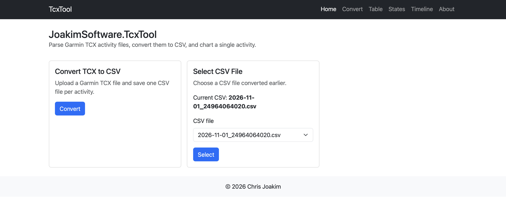
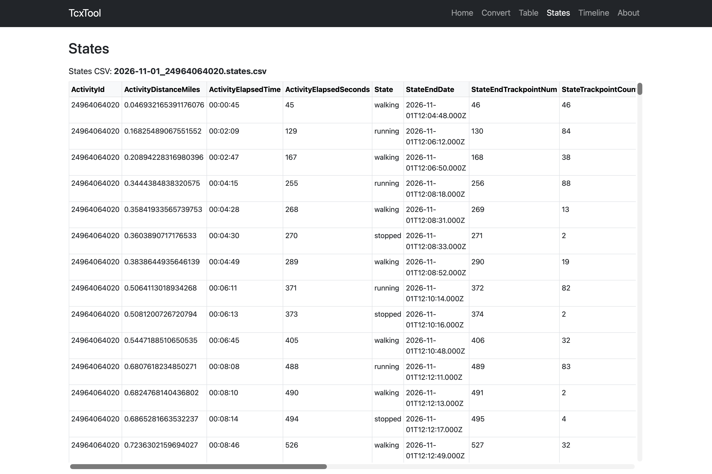
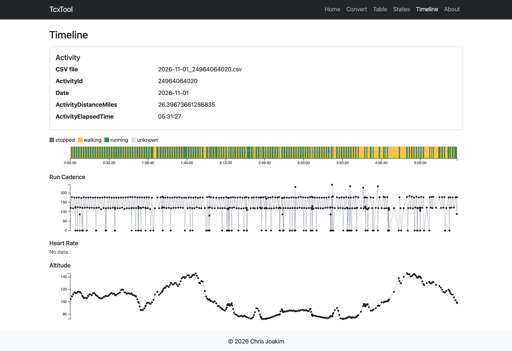
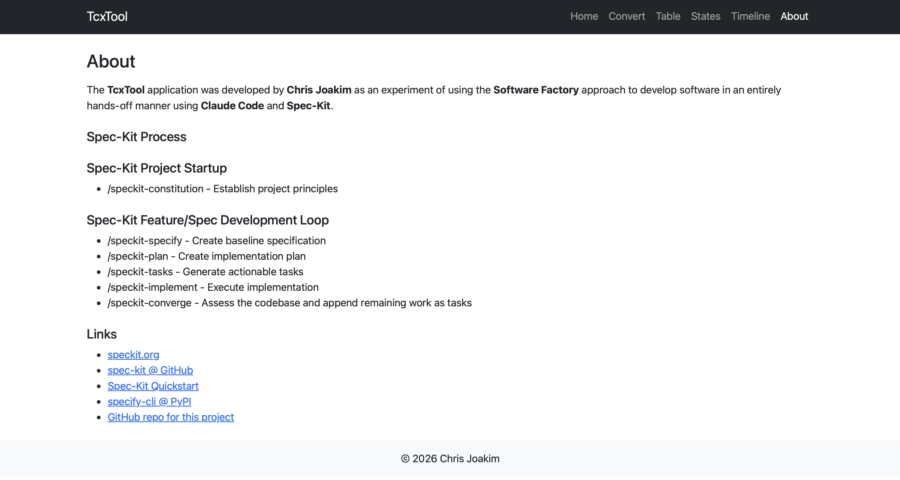

# speckit-tcxtool

What is this project?

This project was my first exploration of 
[GitHub Spec Kit](https://github.com/github/spec-kit) and the concept
of a **Software Factory**.

**Microsoft apparently uses spec-kit internally** for their own development.
This fact is very interesting to me.
See https://developer.microsoft.com/blog/spec-driven-development-ai-native-engineering/

The spec-kit GitHub repository has over **150K stars** and is growing in popularity.

---

## Project Goals 

- Evaluate spec-kit for my own learning and potential future development purposes
- **Develop in an entirely spec-driven and AI manner and write ZERO lines of code manually**
- Create something non-trivial, and interesting and useful to me
- Revisit Development with DotNet/C-sharp as my focus has been on Python in recent years
- Use the Blazor framework for the UI, which I hadn't used before
- Create a working but not highly-polished application; the point is to explore and evaluate spec-kit
- Share my experience with others via this public GitHub repository

---

## The Application - tcxtool

I'm a (slow) marathon runner, and I use [Garmin Running Watches](https://www.garmin.com/en-US/p/886785/).
The Garmin watches capture verbose data in an XML format called **TCX**.
Here's an [example](tcxtool/data/tcx/24932322230.tcx) from my last marathon.

I no longer run marathons non-stop - I run and walk in mostly regular intervals now.

The purpose of the **tcxtool** application is to parse the TCX file into CSV, and perform analysis
and create visualizations with the data.  Specifically, the interval or segment lengths
and their Heart Rate, Turnover Rate (i.e. - steps per minute), Altitude, and other metrics.

---

## The spec-kit Workflow 

All of these steps are executed in your AI tool - Claude Code in this case.

### Spec-Kit Project Startup

First create the "constitution" with the /speckit-constitution skill command.
This creates file **tcxtool/.specify/memory/constitution.md**.

```
/speckit-constitution
```

I actually used this form of the command shown below, as I prefer to draft the prompt in an external 
markdown file first, then use the @file syntax to point to the draft file.

```
/speckit-constitution Use file @../docs/joakimsoftware-tcxtool-constitution-draft.md 
```

This is a one-time task.  Though I did make minor edits to the constitution.md file 
in some cases.

### Spec-Kit Feature/Spec Development Loop

This workflow is executed once per feature in the application.

An advanced Development pattern is to use **github worktrees** to use spec-kit in parallel
feature branches.  This was not explored in this project.

#### Shorter path — for smaller features

Execute these skills in sequence.
spec-kit is very good at guiding the user in "what's the next step?"

```
/speckit-specify
/speckit-plan
/speckit-tasks
/speckit-implement
/speckit-converge
```

### Full path — for production features

```
/speckit-specify
/speckit-clarify
/speckit-plan
/speckit-checklist
/speckit-tasks
/speckit-analyze
/speckit-implement
/speckit-converge
```

As with /speckit-constitution, I prefer to pass the text of the spec 
as an external markdown file, as shown below, that is easier to edit and craft thoughtfully.

```
/speckit-specify @../docs/spec-008-draft.md
```

---

## Conclusions - TL;DR

- I was able to learn spec-kit, and become comfortable with it, in under one day
- The application was developed in under three days, in fragmented working sessions 
- Only once did I reach the Claude Code usage limit (Pro plan, $17/month)
- **I wrote exactly zero lines of code myself**
- ~90%of the code was written by spec-kit, ~10% by Claude Code in ad-hoc prompting sessions
- The **constitution.md** file you provide to spec-kit is an excellent design 
  - It guides Development, much like the CLAUDE.md file does for Claude Code
  - See the [constitution.md](tcxtool/.specify/memory/constitution.md) here
- I found myself appropriately taking the time to be thoughtful in crafting specs
  - Preferred to first these as drafts as Markdown files
  - Then use the /speckit-specify command with the @file syntax pointing to the draft md file
- I also found myself chatting often with Claude Code about both spec-kit and the codebase it created
- I'm extremely impressed with how thoughtful and complete spec-kit is
  - It has a well design workflow that is superior to ad-hoc Vibe-coding with Claude Code
  - It considered things that I, as Developer with 40-years of experience, would have easily overlooked
  - It created high-quality code with extensive unit-tests 
  - It was able to refactor the code as new functionality was added 

---

### Directory Structure of this project 

```
├── docs
│   └── img
└── tcxtool
    ├── .claude           the usual Claude Code skills, rules, etc
    ├── .specify          spec-kit Claude skills, rules, memory, etc
    ├── .specify/memory/constitution.md
    ├── data
    │   ├── csv
    │   └── tcx
    ├── specs
    │   ├── 001-project-bootstrap
    │   ├── 002-tcx-to-csv
    │   ├── 003-claude-ui-enhancements
    │   ├── 004-about-and-csv-state
    │   ├── 005-table-page
    │   ├── 006-activity-states
    │   ├── 007-timeline-page
    │   └── 008-remove-histograms-page
    ├── src
    │   ├── JoakimSoftware.TcxTool.Parser
    │   └── JoakimSoftware.TcxTool.Web
    └── tests
        └── JoakimSoftware.TcxTool.Tests
```

### The Code that was Generated 

- 4872 lines in 105 files in the **tcxtool/src** directory
- 69 *.cs (C-sharp) files
- 36 *.razor (Blazor) files
- It appears to be readable, well-organized, well-written, and maintainable

---

## The Implementation Details 

The remainder of this page shows how I got started with spec-kit.

It also provides screen-shots of the resulting **tcxtool** application 
and how to run it yourself.

I Develop on macOS with zsh and the dotnet CLI.
I'll leave it as an exercise for the reader to run the application on other platforms.

## Getting Started - a C# Blazor TCX Web App Project

### Install spec-kit with uv

- See https://github.github.io/spec-kit/installation.html 
- See https://pypi.org/project/specify-cli/

In zsh in iTerm2 on macOS:
```
% dotnet --version
11.0.100

% brew --version
Homebrew 7.0.15

% uv --version
uv 0.13.9 (Homebrew 2026-11-17 aarch64-apple-darwin)

% uv tool list
No tools installed

% uv tool install specify-cli

% uv tool list
specify-cli v1.4.3
- specify
```

### Create Project with the specify CLI 

```
% specify init --help > docs/specify-init-help.md

% specify init tcxtool --integration claude
                                  ███████╗██████╗ ███████╗ ██████╗██╗███████╗██╗   ██╗
                                  ██╔════╝██╔══██╗██╔════╝██╔════╝██║██╔════╝╚██╗ ██╔╝
                                  ███████╗██████╔╝█████╗  ██║     ██║█████╗   ╚████╔╝
                                  ╚════██║██╔═══╝ ██╔══╝  ██║     ██║██╔══╝    ╚██╔╝
                                  ███████║██║     ███████╗╚██████╗██║██║        ██║
                                  ╚══════╝╚═╝     ╚══════╝ ╚═════╝╚═╝╚═╝        ╚═╝

                                   GitHub Spec Kit - Spec-Driven Development Toolkit

... dialog not shown here ...
```

See the [Constitution Creation and Spec 001 Details](docs/consittution-and-spec-001.md)

---

## Running the Application Locally

```
% cd tcxtool
% ./run.zsh 

Then visit http://localhost:5169 with your web browser.
```

---

## What about Docker, Compose, and Cloud-deployment? 

spec-kit created the Dockerfile and compose.yml files.

I'm leaving it as an exercise for the reader to deploy to Azure or another cloud.
Again, the purpose of this project is to explore spec-kit.

---

## Claude Code and Usage Limits 

This happened just once while I developed this project
as I was using my personal Claude Code Pro account ($17/month).

```
⏺ Usage limit reached again · set to continue automatically at 5pm
  ⎿  You've hit your 5-hour limit · resets 5pm (America/New_York)
```

---

## Screen Shots of the resulting TcxTool application

#### Home Page 

<p align="center">
  
</p>

#### States Page (running or walking segments)

<p align="center">
  
</p>

#### Timeline Page with vertically-correlated charts

<p align="center">
  
</p>

#### About Page 

<p align="center">
  
</p>
